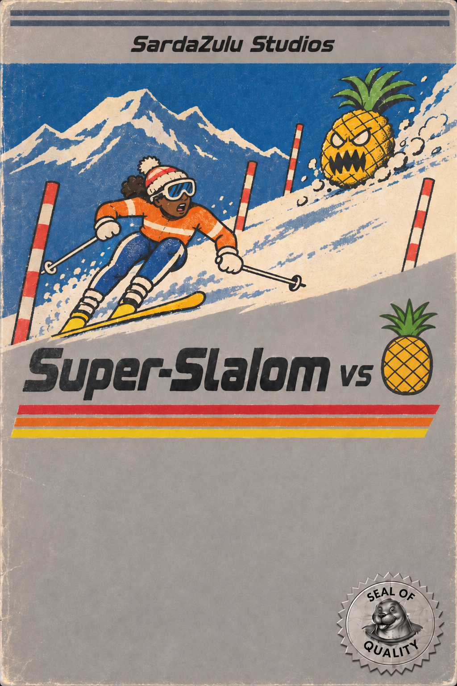
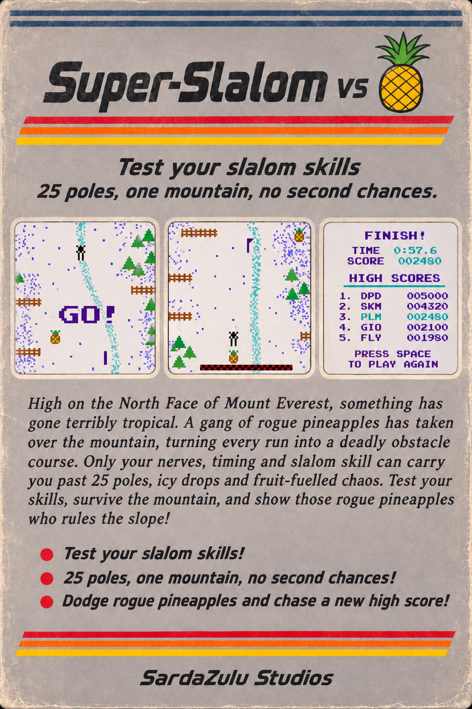

# Super Slalom vs Pineapple
A super slalom ski game inspired by an old VIC-20 game lost in time

  
  

**Play:** https://gidili.github.io/super-slalom-20/

## Modes

- **Single:** one mountain, 25 poles, no second chances.
- **Championship:** 10 out of 14 legendary mountains, in the order you choose, from Alaska to the North Face of Everest.
- **Endless:** a slope that never ends. A crash or 4 misses and it's over.

## On the slope

- Pass each pole on the side its flag points to.
- Brush the poles as you go: a streak of them is worth a lot.
- Trees, fences, pineapples and the odd bear will end your run.

## Controls

- **Computer:** hold ← → (or A / L, or the Shifts) to turn. Space starts and pauses, R restarts, M mutes.
- **Phone:** hold the arrows in the bottom corners to turn. Tap a mode to start, and the screen to pause.
- **Controller:** d-pad or stick to turn, Start to start and pause.

The **crown** shows the leaderboards.

Do you have what it takes to succeed?
